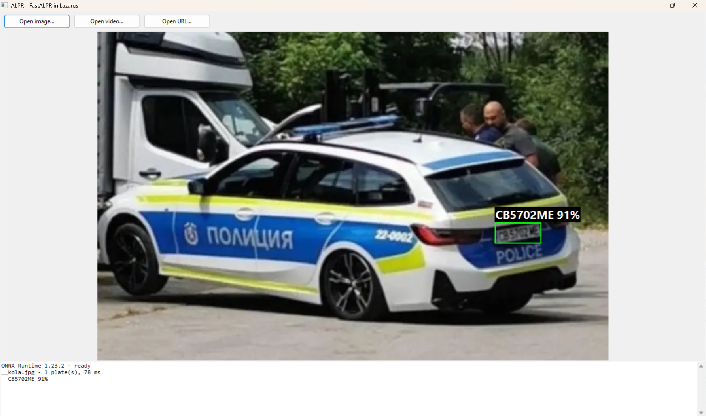
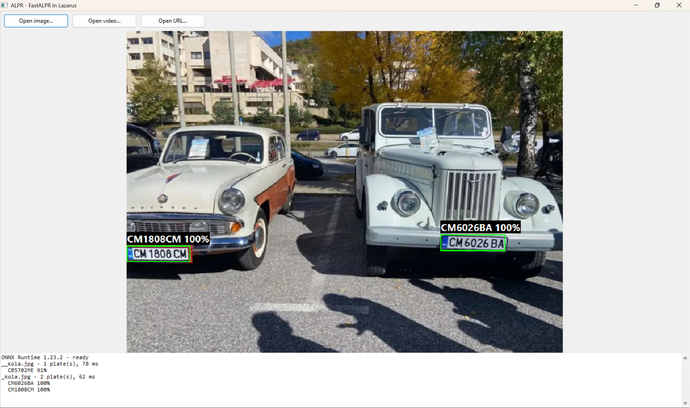
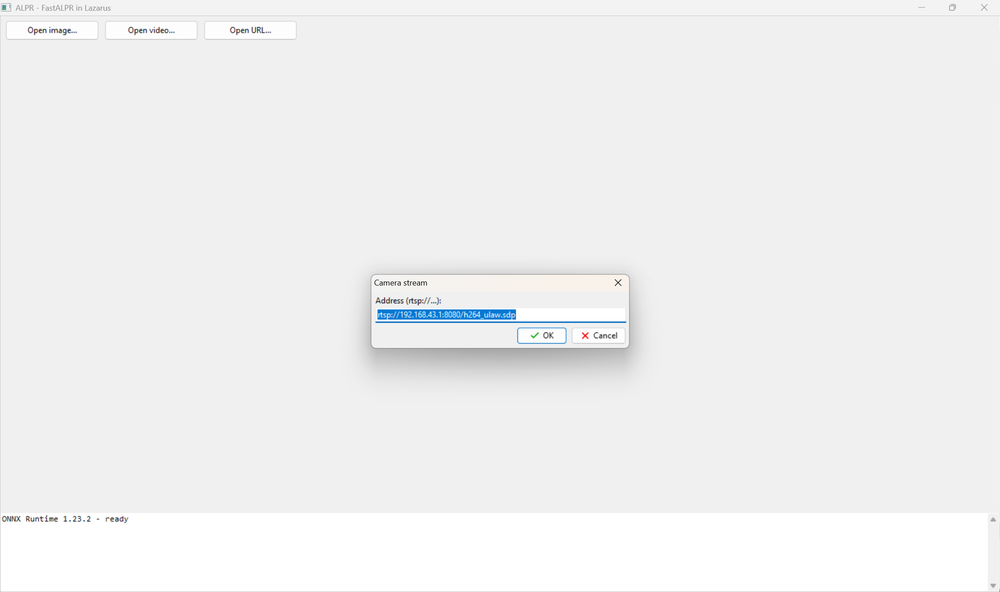

# ALPR — разпознаване на регистрационни номера с Lazarus / Free Pascal

Разпознаване на регистрационни номера изцяло в Pascal, без Python. Ползва ONNX моделите на [FastALPR](https://github.com/ankandrew/fast-alpr) през ONNX Runtime и дава същите резултати като оригинала.

- снимки, видеофайлове и RTSP поток от камера
- по едно събитие на кола при видео (гласуване между кадрите)
- Windows: видеото се чете през Media Foundation — нищо за инсталиране
- около 50 ms на кадър 1280×720 на обикновен процесор



<p>
  
  
</p>

## Подредба

```
model\        моделите (детектор + OCR + конфигурация)
gui\          Lazarus програма с бутони Open image / Open video / Open URL
*.pas         модулите
alprvideo.lpr конзолна програма за видео и камера
alprtest.lpr  конзолен тест за снимка
tools\        Python скриптове за проверка на моделите
testdata\     тестови снимки
Screenshots\  снимки на програмата
```

| Модул | Какво прави |
|---|---|
| `onnxrt.pas` | Минимална връзка към ONNX Runtime (C API), зарежда DLL-а динамично |
| `fastalpr.pas` | Детектор + OCR (`TAlpr`) |
| `platetracker.pas` | Събира прочитанията от много кадри в едно събитие за кола |
| `framesource.pas` | Общ интерфейс за кадри + `TFFmpegSource` (ако ползвате ffmpeg) |
| `mfvideo.pas`, `mfdecl.pas` | Кадри през Windows Media Foundation |

## Нужно

1. **64-битов Lazarus** (проверено с FPC 3.2.2).
2. **`onnxruntime.dll`** до exe-то — от [ONNX Runtime releases](https://github.com/microsoft/onnxruntime/releases), архив `onnxruntime-win-x64-*.zip`, папка `lib`. Версия 1.14 или по-нова.
3. Моделите в `model\`:
   - `yolo-v9-t-384-license-plates-end2end.onnx` — от [open-image-models](https://github.com/ankandrew/open-image-models)
   - `cct_xs_v1_global.onnx` и `cct_xs_v1_global_plate_config.yaml` — от [fast-plate-ocr](https://github.com/ankandrew/fast-plate-ocr)

Подавайте **пълния път** до DLL-а: Windows има и собствен, стар `onnxruntime.dll` в System32, който иначе може да се зареди вместо вашия.

## Компилиране

Отворете `gui\alprgui.lpi` или `alprvideo.lpi` в Lazarus и натиснете Build. От командния ред:

```
lazbuild gui\alprgui.lpi
lazbuild alprvideo.lpi
```

## Използване

**Програмата с прозорец** (`gui\alprgui.exe`):
- **Open image** — снимка с рамки и номера
- **Open video** — видеофайл; показва кадрите и пише по един ред на кола
- **Open URL** — поток от камера, например `rtsp://192.168.1.10:8080/h264_ulaw.sdp`

Зелена рамка — сигурно прочитане, жълта — несигурно (не се брои).

**Конзолата:**

```
alprvideo.exe запис.mp4
alprvideo.exe запис.mp4 --bg                       само валидни български номера
alprvideo.exe rtsp://адрес --verbose               ред за всеки кадър (за настройка на камерата)
alprvideo.exe rtsp://адрес --verbose --save        записва кадрите с табела като debug_N.png
```

Изход — по един ред на кола:
```
00:04.2  PB1945BA   votes 3/4  conf 1.00
```

## Камери

Media Foundation чете **RTSP с H.264**. Не чете MJPEG по HTTP (`http://.../video`, `http://.../stream`) — за него трябва `ffmpeg.exe` (`--ffmpeg път`).

Телефон като камера: **IP Webcam** (Android) — `rtsp://ТЕЛЕФОН:8080/h264_ulaw.sdp`. Телефонът трябва да е хоризонтално; обърната картина дава безсмислени прочитания (проверява се с `--save`).

## В собствен код

```pascal
uses FastAlpr, PlateTracker, MFVideo;

Alpr := TAlpr.Create('C:\alpr\onnxruntime.dll',
  'C:\alpr\model\yolo-v9-t-384-license-plates-end2end.onnx',
  'C:\alpr\model\cct_xs_v1_global.onnx',
  'C:\alpr\model\cct_xs_v1_global_plate_config.yaml');

// снимка
Res := Alpr.PredictFile('kola.jpg');   // Res[I].Plate.Text, Res[I].Plate.Confidence, Res[I].Box

// видео или камера
Src := TMFSource.Create('rtsp://...', 0.2);           // 5 кадъра в секунда
Tracker := TPlateTracker.Create;
Tracker.OnPlate := @OnPlate;                          // procedure(const E: TPlateEvent) of object
Tracker.Filter := @IsBulgarianPlate;                  // по желание
while Src.ReadFrame(Img, T) do
  Tracker.Feed(Alpr.Predict(Img), T, Img.Width, Img.Height);
Tracker.Flush;
```

Създавайте `TAlpr` веднъж и го ползвайте многократно — зареждането на моделите е бавната част. Ако викате `Predict` от собствена нишка, извикайте в началото ѝ `MaskFPUExceptions` (от `onnxrt.pas`).

Настройки на `TPlateTracker`:
- `ConfirmVotes` (3) — колко еднакви прочитания трябват, за да се съобщи номерът
- `MinConfidence` (0.8) — по-несигурните прочитания се пренебрегват
- `LostAfter` (1.5 s) — след толкова време без табела колата се смята за заминала
- `Cooldown` (30 s) — същият номер не се съобщава повторно
- `EdgeMargin` (3 px) — табели, допрени до ръба на кадъра, се пренебрегват (обикновено са срязани)

## Лиценз и благодарности

Моделите са на [ankandrew](https://github.com/ankandrew) — [fast-plate-ocr](https://github.com/ankandrew/fast-plate-ocr) и [open-image-models](https://github.com/ankandrew/open-image-models), лиценз MIT. ONNX Runtime е на Microsoft, лиценз MIT.

Регистрационните номера са лични данни. Ако програмата записва номера на хора, които не са ваши служители или клиенти, проверете изискванията на GDPR.
